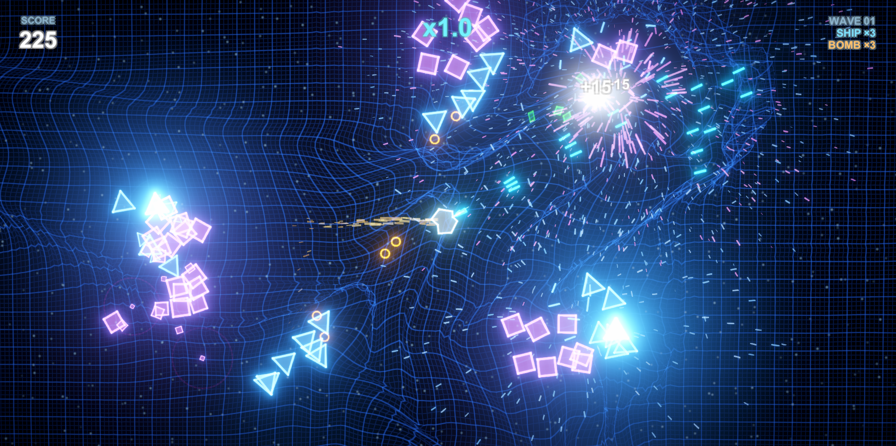

# Geometry Clash

[English](README.md) | **简体中文**

一个致敬《几何战争：复古进化》(Geometry Wars: Retro Evolved) 的双摇杆射击游戏。
**没有任何美术/音频资源**：所有网格、材质、粒子、音效都在运行时由代码生成。

> **[在浏览器里直接玩 →](https://play.unity.com/en/games/56f625fd-fdff-44f4-a08b-75962a3f008b/geometry-clash)**
> 不用下载，WebGL 版本跑在 Unity Play 上。



## 运行方式

1. 用 Unity 6 打开本工程（6000.3.27f1 / URP 17）。
2. 打开 `Assets/GeometryClash.unity`，按 **Play**。

## 程序入口

场景里**只有一个物体**：`GeoClash`，上面挂着 `Game` 组件（`Assets/Scripts/Game.cs`）。

其余一切——相机、弹簧网格地面、玩家飞船、HUD 画布、后处理 Volume、音效源——
都在 `Game.Awake()` 里用代码创建，所以**场景视图里看不到它们是正常的**，
运行后才会出现在 Hierarchy 里（`GeoClash/MainCamera`、`GeoClash/World`、`GeoClash/Hud` 等）。

`Game` 组件在 Inspector 里能看到实时状态（State / Score / Lives / Bombs / Wave / Multiplier），
Play 模式下可以直接观察数值变化。

> 兜底：`Boot.cs` 里的 `[RuntimeInitializeOnLoadMethod]` 会在**任何**场景按 Play 时
> 检查是否存在 `Game`，没有就自动补建一个。

## 操作

| 动作 | 键鼠 | 手柄 |
| --- | --- | --- |
| 移动 | WASD / 方向键 | 左摇杆 |
| 瞄准 | 鼠标 | 右摇杆 |
| 射击 | 鼠标左键（按住） | 右扳机 / 推右摇杆 |
| 冲刺（短暂无敌） | Shift | RB |
| 炸弹（清场） | 空格 | LB |
| 暂停 | Esc | Start |
| 静音 | M | — |

## 已实现的核心系统

- **双摇杆射击**：飞船朝向独立于移动方向，鼠标/右摇杆瞄准。

- **9 种几何体敌人**（每种一套 AI）：

  | 敌人 | 形状 | 行为 |
  | --- | --- | --- |
  | Grunt | 紫色方块 | 直线追击 |
  | Wanderer | 蓝色三角 | 漂移反弹，间歇射击 |
  | Dodger | 绿色菱形 | 逃跑绕圈，死亡分裂成两个小菱形 |
  | Spinner | 青色六边形 | 悬停游走，向四周放射弹幕 |
  | Chomper | 红色三角 | 蓄力后高速直线冲锋 |
  | Gravity | 橙色五边形 | 慢速漂移，持续把玩家拉向自己 |
  | Weevil | 黄色小三角 | 高速蛇形追击 |
  | Hole | 品红圆环 | 强力引力，接触即死，血厚 |
  | Boss | 大六边形 | 每 5 波出现：螺旋弹幕 + 召唤 Weevil |

- **波次系统**：预算制随机编排，敌人成组从场外飞入，血量/数量随波次上升，每 5 波一个 Boss。

- **超能力**：冲刺（无敌位移）、炸弹（范围清场 + 清除敌方子弹 + 网格冲击波）。

- **弹簧质点网格**：整块场地是一张 **33,417 个质点**的质量-弹簧网（237×141，格距 0.35）。
  子弹、撞击、爆炸都会施加冲量，扰动以波的形式传播、在边界反射、按阻尼衰减。
  模拟用 Burst 编译的 `IJobParallelFor` 跑。

- **主角复活**：黑洞式网格持续坍缩 + 弹片 + 专属音效，0.2 秒后现身，附带 3 秒无敌环。

- **深度点云**：场地后方一层泊松盘分布的 3D 点阵，相机平移时产生视差，让画面有体积感。

## 代码结构

```
Assets/
├── GeometryClash.unity        场景（只有 GeoClash 一个物体）
├── Resources/                 ← shader 必须放这里，否则打包时会被剥离
│   ├── Neon.shader            叠加混合 HDR 霓虹（几何体/粒子/子弹/拖尾）
│   └── GridCell.shader        弹簧网格单元：大格线 + 小格线 + 顶点圆点
├── Scripts/
│   ├── Boot.cs                运行时自动启动
│   ├── Game.cs                主控：波次/计分/碰撞/镜头/后处理
│   ├── Player.cs              玩家移动、瞄准、射击、冲刺、复活
│   ├── Enemy.cs               9 种敌人行为（Kind 分派）
│   ├── Bullet.cs / Geom.cs    子弹与 Geom（对象池）
│   ├── Fx.cs                  粒子 + 爆炸 + 冲击波环 + 震屏（含边界回弹）
│   ├── SplitFx.cs             敌人死亡时把轮廓拆成碎片飘散
│   ├── SpringGrid.cs          弹簧质点网格（Burst + Jobs）
│   ├── DepthField.cs          场地后方的 3D 泊松点云
│   ├── Sfx.cs                 程序化音效（全部合成，无音频文件）
│   ├── Hud.cs                 uGUI 界面 + 得分飘字
│   ├── Controls.cs            输入封装（键鼠 + 手柄）
│   ├── Crosshair.cs           准星光标（程序化生成贴图）
│   ├── Meshes.cs              网格生成（多边形轮廓/填充/环/飞船）
│   ├── MatLib.cs              材质缓存与共享材质
│   ├── Pool.cs                对象池
│   ├── Palette.cs             配色（HDR 值决定辉光强度）
│   ├── ExplosionProfile.cs    爆炸参数
│   └── SuctionProfile.cs      复活黑洞参数
├── Settings/                  URP 管线资源
└── InputSystem_Actions.inputactions  输入系统资产
```

## 调参入口

- **难度 / 节奏**：`Game.StartWave()` 里的 `budget`（当前是 `(7+n*5)*15`），
  `Kinds/Weights/UnlockWave/Cost` 四个表，以及刷新点 `SpawnPoint()` 的 `minDist`（默认 15，
  即敌人不会刷在主角 15 单位以内）。
- **敌人强度**：`Enemy.Setup()` 里的 `switch (kind)`。
- **手感**：`Player.cs` 顶部的 `Speed / Accel / DashSpeed` 与 `Fire()` 里的射速、弹速。
- **辉光强度**：`Palette.cs` 的颜色分量（>1 才会触发 Bloom），以及 `Game.BuildPostFx()` 的阈值/强度。
- **场地大小**：`Game.AX / AY`（当前 **41.3 / 24.5**，即 82.6 × 49）。
  改完要注意 `SpringGrid` 的质点数是 `(2AX/Cell+1) × (2AY/Cell+1)`，`Cell` 当前 **0.35**。
- **掉落物密度**：`Game.GeomDropRate`（当前 0.2，即只有 20% 的掉落量）。
- **吸附范围/力度**：`Geom.cs` 顶部的 `AttractRange`（40，全程缓慢吸引）/
  `MagnetRadius`（4.2 = 3 个大格，进入后急吸）/ `CollectRadius`（2.0，自动拾取）。
- **敌人靠近速度**：`Enemy.cs` 的 `leashNear / leashFar`（13 / 22）——
  超过 13 单位开始被拉回主角，22 单位以上完全直冲。
- **倍率成长**：`Game.GeomMultiplierGain`（当前 0.6）、`multGrace`（拾取后 2.5 秒缓冲）
  与 `dt * 0.06f`（衰减速度）。
- **一屏范围**：`Game.UpdateFraming()` 里的 `targetHalfW / targetHalfH`（当前 **26.6 / 17.5**）。
- **网格弹性**：`SpringGrid.cs` 顶部的 `Cell / SpringK / AnchorK / Damping / MaxOffset`。
- **爆炸**：`ExplosionProfile.Default` —— 白闪 / 主弹片 / 震屏 / 网格，四组各带 `xxxOn` 开关。
- **复活黑洞**：`SuctionProfile.Default`。

## 许可

[MIT](LICENSE) © 2026 张成悟

工程里没有任何第三方美术或音频资源 —— 所有网格、材质、粒子、音效都是运行时由代码生成的，
所以整份代码可以自由使用、修改、再分发。

本项目是《几何战争：复古进化》的**玩法致敬**，与其开发商无关，也未使用其任何素材。
